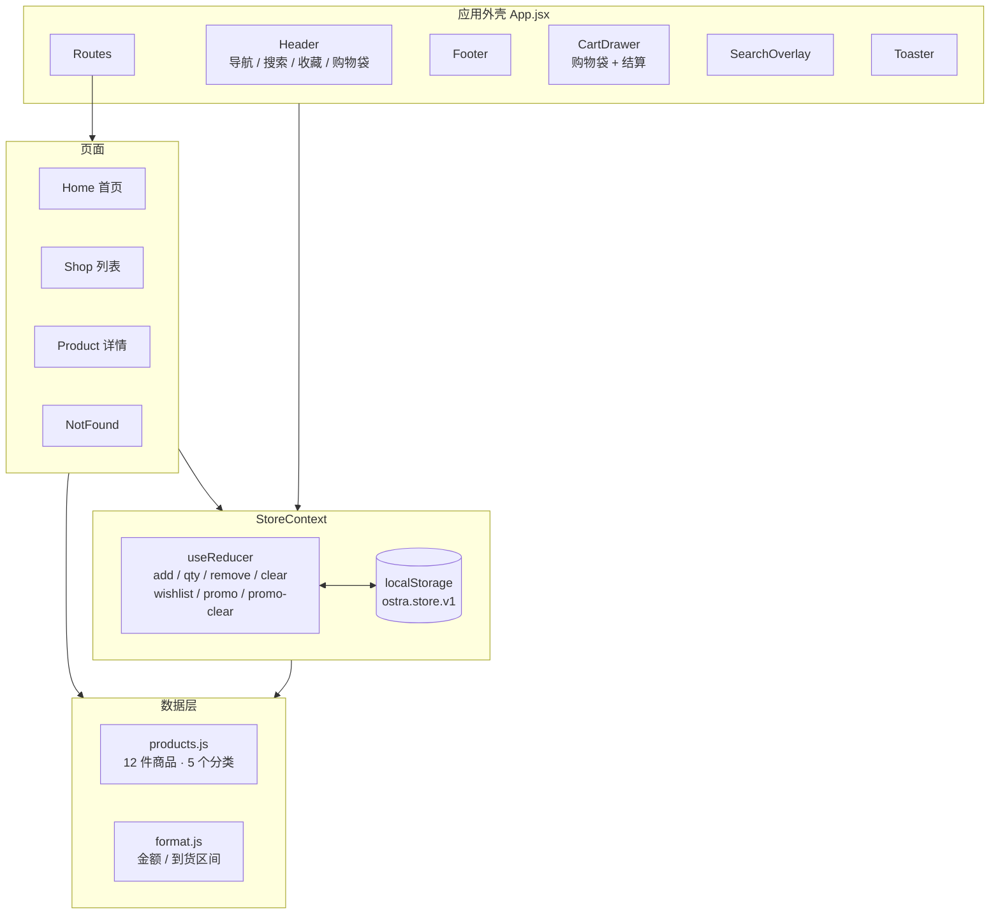

# Ostra 商品选购 Web 应用 · 交付文档

| 项目 | 内容 |
| --- | --- |
| 项目名称 | Ostra — Considered objects for everyday rituals |
| 产物形态 | 面向海外消费者的商品选购 Web 应用（React 单页应用） |
| 交付版本 | v1.0.0（commit `446755f`） |
| 交付日期 | 2026-10-19 |
| 在线地址 | https://ostra-store.app.workbuddy.host/ |
| 代码仓库 | https://github.com/sumuzhi/ostra-store |
| 文档范围 | 功能范围、技术方案、设计系统、部署运维、验收记录、已知限制 |

---

## 1. 项目概览

### 1.1 定位

Ostra 是一个**小批量家居器物品牌**的直营店。交付物的目标不是"把商品列出来"，而是复现海外 DTC 品牌线上店的选购节奏：先被氛围说服，再被细节说服，最后才看到价格。

### 1.2 目标用户与选购路径

| 用户类型 | 行为特征 | 对应设计 |
| --- | --- | --- |
| 闲逛型（Inspiration） | 没有明确目标，靠图片与氛围触发兴趣 | 首页以大幅生活方式图开场，商品以"编辑精选"而非"促销货架"呈现 |
| 目标型（Intent） | 已知要买什么，需要快速定位与比较 | 搜索浮层（⌘K / 点击图标）、分类筛选、价格与库存筛选、四种排序 |
| 犹豫型（Consideration） | 关心材质、尺寸、运费、退换 | 详情页规格色卡、尺寸与产地、折叠式材质/物流说明、到货日期预估 |
| 决策型（Checkout） | 已在购物车，关心总价与运费门槛 | 抽屉内免运费进度条、折扣码、三步结算、订单确认页 |

### 1.3 一句话价值

> 让一个没有品牌认知的海外消费者，在 90 秒内完成"看氛围 → 找到商品 → 确认细节 → 下单"的完整链路，且手机与桌面体验一致。

---

## 2. 交付清单

| # | 交付物 | 位置 | 说明 |
| --- | --- | --- | --- |
| 1 | 在线可访问站点 | https://ostra-store.app.workbuddy.host/ | 已发布并验证，可直接发给客户 |
| 2 | 源代码仓库 | https://github.com/sumuzhi/ostra-store | public，默认分支 `main`，44 个受版本控制文件 |
| 3 | 本地工程 | `/Users/sumuzhi/WorkBuddy/2026-10-19-14-44-12` | 可直接 `npm install && npm run dev` |
| 4 | 生产构建产物 | `dist/`（2.9 MB） | 含 13 条路由外壳，可直接托管于任意静态服务器 |
| 5 | 本文档 | `DELIVERY.md` | 交付验收与技术交接依据 |

---

## 3. 功能范围

### 3.1 功能矩阵

| 模块 | 能力 | 实现要点 | 验收状态 |
| --- | --- | --- | --- |
| 首页 | 首屏 Hero + 编辑精选卡 + 分类入口 + 品牌承诺 + 场景图文 | 非轮播，单张主视觉 + 悬浮商品卡，降低首屏噪音 | ✅ |
| 商品列表 | 12 件商品网格 | 3 列（≥860px）/ 2 列（<860px）；名称预留两行保证评分行对齐 | ✅ |
| 分类筛选 | Kitchen / Textiles / Lighting / Desk / Objects | 侧栏多选，实时显示各分类命中数 | ✅ 12 → 3（Textiles） |
| 价格筛选 | Under $50 / $50–$100 / Over $100 | 与分类、库存为**交集**关系 | ✅ |
| 库存筛选 | In stock only | 基于 `stock > 0` | ✅ |
| 排序 | Featured / 价格升序 / 价格降序 / Top rated | 价格降序时按实际售价比较（含折扣价） | ✅ $42 → $165 → $210 |
| 搜索 | 浮层实时搜索，匹配名称、简介、分类、标签 | 输入即过滤，附"查看全部结果"，Esc 关闭 | ✅ "linen" 命中 2 件 |
| 商品详情 | 图库 + 缩略图、徽章、评分、规格色卡、数量、收藏、加购、到货预估、四段折叠说明、评价区、搭配推荐 | 变体选择影响加购行（颜色/选项随行记录） | ✅ |
| 购物车 | 抽屉式，加购 / 改数量 / 删除 / 免运费进度 / 小计-折扣-运费-总计 | 固定右侧抽屉，Esc 与遮罩可关闭，打开时锁定背景滚动 | ✅ |
| 折扣码 | `WELCOME10`（9 折）、`FREESHIP`（免运费） | 折扣在运费前计算；无效码给出明确文案 | ✅ $56 → $58.40（含运费） |
| 结算 | 抽屉内三步：购物袋 → 收货信息 → 订单确认 | 6 项前端校验，错误聚焦首个字段，逐字段即时消除错误态 | ✅ 校验 6 项全触发 |
| 订单确认 | 订单号、邮箱、到货区间、件数、实付、商品清单 | 下单后清空购物车并落盘 | ✅ 订单号 `OS-xxxxx` |
| 收藏 | 商品卡与详情页心形，跨页面同步 | 与购物车同源状态，持久化 | ✅ |
| 状态持久化 | 刷新后购物车、收藏、折扣码不丢 | `localStorage` key `ostra.store.v1`，读取时做结构校验 | ✅ 刷新后 cart 长度保持 |
| 响应式 | 8 档视口实测 | 断点 1100 / 860 / 640 / 380；≤1100 侧栏筛选收为「Filters」底部抽屉 | ✅ 全部 0 横向溢出 |
| 可访问性 | 语义化标题层级、`aria-label`、`aria-pressed`、进度条 `role="progressbar"`、跳转链接、焦点管理 | 抽屉打开时焦点移至关闭按钮，Esc 关闭 | ✅ |
| 404 | 未知路径与未知 slug | 保留品牌语气的空状态 + 返回入口 | ✅ |

### 3.2 明确不在本期范围

按"先做深一条主链路"的原则主动裁剪，避免样样都有、样样都浅：

- 用户账号、登录、订单历史
- 真实支付（结算为演示态，页面明示"No payment is taken"）
- 库存扣减、并发下单、后端校验
- 多语言与多币种（文案与价格均为英文 / USD）
- 商品评价的提交与审核（仅展示聚合评分）

---

## 4. 技术方案

### 4.1 技术栈

| 层次 | 选型 | 版本 | 选择理由 |
| --- | --- | --- | --- |
| 构建 | Vite | ^6.0.7 | 冷启动快，构建产物体积小，配置面窄 |
| 视图 | React | ^19.1.0 | 组件化与状态可预测，团队熟悉度最高 |
| 路由 | react-router-dom | ^7.1.1 | 支持嵌套路由、`useSearchParams` 让筛选条件可分享 |
| 样式 | 原生 CSS（4 个分层文件 + CSS 变量） | — | 设计令牌集中管理，无运行时开销，避免为一个小型站点引入 CSS-in-JS |
| 状态 | Context + `useReducer` | 内置 | 状态单一（购物车/收藏/折扣码），无需 Redux 或额外依赖 |
| 持久化 | `localStorage` | 内置 | 无后端前提下最省事的会话延续方案 |
| 图标 | 手写 SVG 组件 | — | 统一 1.4px 描边与视觉重量，避免图标库风格不一致 |
| 图片 | 静态 JPEG（ImageGen 生成，统一影调） | — | 演示环境可控、离线可用、无第三方图床依赖 |

**依赖总量：3 个运行时依赖 + 2 个开发依赖。** 这是刻意的取舍——交付物要能被任何前端在半天内接手。

### 4.2 架构



### 4.3 路由表

| 路径 | 页面 | 说明 |
| --- | --- | --- |
| `/` | Home | 首页 |
| `/shop` | Shop | 支持 `?cat=` `?price=` `?sort=` `?stock=` `?q=` 查询参数，**筛选后的视图可直接分享** |
| `/product/:slug` | Product | 12 个有效 slug；未知 slug 落到 NotFound |
| `*` | NotFound | 兜底 |

### 4.4 数据模型

`src/data/products.js`

| 字段 | 类型 | 说明 |
| --- | --- | --- |
| `id` / `slug` | string | 内部主键 / URL 友好标识 |
| `name` / `blurb` | string | 名称 / 一句话卖点（列表页 clamp 一行） |
| `category` | enum | kitchen / textiles / lighting / desk / decor |
| `price` / `compareAt` | number（**分**） | 金额一律整数分存储，杜绝浮点误差；`compareAt` 存在时展示划线价 |
| `colors` | `{name, hex}[]` | 规格色，详情页色卡与加购行共用 |
| `options` | string[] | 尺寸/规格选项（如 S/M/L） |
| `stock` | number | `≤5` 时列表与详情页显示库存紧张 |
| `rating` / `reviews` | number | 评分与评价数 |
| `badge` | string? | Bestseller / New / Set of 4 |
| `materials` / `dims` / `origin` / `care` | string | 详情页折叠面板内容 |
| `tags` / `pairs` | string[] | 搜索标签 / 搭配推荐（指向其他商品 id） |

**商品构成**：12 件，价格区间 $28 – $210，覆盖 5 个分类（Kitchen 3 / Textiles 3 / Lighting 2 / Desk 2 / Objects 2），其中 1 件带划线价、5 件带徽章、2 件低库存。

### 4.5 状态管理

`src/store/StoreContext.jsx`，单一 `useReducer`，action 与副作用分离：

| Action | 载荷 | 效果 |
| --- | --- | --- |
| `add` | `{product, color, option, qty}` | 同商品同规格合并数量，否则新增行；行 key 由 `id + color + option` 生成 |
| `qty` | `{key, qty}` | 设为 0 时等同删除 |
| `remove` / `clear` | `key` / — | 删除单行 / 清空 |
| `wishlist` | `id` | 收藏切换 |
| `promo` / `promo-clear` | `code` / — | 应用 / 移除折扣码 |

派生值（`subtotal`、`discount`、`shipping`、`total`、`remainingForFree`、`count`）全部在一次 `useMemo` 内计算，组件不重复算钱。

**结算规则**：满 **$120** 免运费，否则固定 **$8**；折扣先于运费计算；`FREESHIP` 直接把运费置零。

### 4.6 关键实现决策与踩坑记录

| # | 问题 | 根因 | 处置 |
| --- | --- | --- | --- |
| 1 | 详情页大图被渲染成原图 1170px 高，图库错位 | `` 上的 `height` 属性优先级高于 CSS `aspect-ratio` | 在 `base.css` 中对 `img` 显式 `height: auto`，容器用 `aspect-ratio` 控制比例 |
| 2 | 滚动动画元素不显示（`opacity: 0` 卡住） | `IntersectionObserver` 在快速滚动/无重排时未触发 | 重写 `Reveal`：进入视口即置位，并加 300ms 兜底定时器 |
| 3 | Toast 出现在购物车抽屉内部，压住免运费进度条 | 定位为固定右上，与右侧抽屉重叠 | 改为桌面左下 / 手机底部，**且抽屉或搜索打开时整体不渲染**（此时提示本就冗余） |
| 4 | 手机端"收藏"按钮被挤到第二行 | 购买区 `flex-wrap` 遇上 `min-width: calc(100% - 128px)` | 改为 `grid-template-columns: auto minmax(0,1fr) 46px`，三件一行 |
| 5 | 商品卡评分行高低不齐 | 商品名 1 行 / 2 行导致下方内容错位 | `.card__name` 预留 `min-height: 2.5em`，行内基线统一 |
| 6 | **静态托管下 `/shop` 与商品页刷新即 404** | 托管方对未知路径返回自有 404 页，无 SPA 重写规则 | 构建后把应用外壳写入每条路由的真实路径（详见 6.3） |
| 7 | 折扣码输入框把占位符也大写，像标签而非提示 | `text-transform: uppercase` 作用于整个输入框 | 单独为 `::placeholder` 复位 |

---

## 5. 视觉与设计系统

### 5.1 设计意图

用**纸感底色 + 衬线标题 + 单向软光**营造"器物店"的安静感，避免电商常见的红黄高饱和刺激。价格与操作区域保持克制，只在"加入购物袋"一处使用深墨实心按钮作为视觉锚点。

### 5.2 色板

| 令牌 | 色值 | 用途 |
| --- | --- | --- |
| `--bone` | `#F7F3EB` | 页面底色（暖米） |
| `--paper` | `#FFFCF7` | 卡片、抽屉、浮层底色 |
| `--sand` | `#ECE4D7` | 图片占位、次级区块 |
| `--ink` | `#1B1916` | 主文字、主按钮 |
| `--ink-2` | `#57504A` | 正文次级 |
| `--ink-3` | `#8A8076` | 辅助说明、占位符 |
| `--line` | `rgba(27,25,22,.12)` | 分隔线 |
| `--line-strong` | `rgba(27,25,22,.24)` | 输入框描边 |
| `--clay` | `#B4553C` | 强调色（折扣、收藏态、低库存） |
| `--sage` | `#6F7758` | 成功态（已加购、折扣生效） |

### 5.3 排版与尺度

| 项 | 值 |
| --- | --- |
| 标题字族 | Fraunces（衬线，回退 Iowan Old Style / Georgia） |
| 正文字族 | Inter（回退 system-ui） |
| 正文 | 15px / 1.55 |
| 容器最大宽 | 1320px，两侧留白 `clamp(20px, 3.4vw, 40px)` |
| 圆角 | 2px（刻意的锐利，贴合器物摄影的硬边光） |
| 图片比例 | 商品 4:5，场景图 3:2 |
| 动效曲线 | `cubic-bezier(.22,.72,.24,1)`；进入视口 0.6s 淡入上移 14px |
| 纹理 | `body::before` 3px 网点叠加，避免大面积平色显"数字化" |

---

## 6. 工程结构与运行

### 6.1 目录结构

```
.
├── index.html                 # 应用入口（含 OG / 字体预连接）
├── vite.config.js
├── package.json
├── scripts/
│   └── prerender-shells.mjs   # 构建后生成路由外壳（36 行）
├── public/
│   ├── favicon.svg
│   └── img/                   # 14 张商品/场景图（2.1 MB）
└── src/
    ├── main.jsx               # 挂载 + 样式引入顺序
    ├── App.jsx                # 外壳、路由、滚动复位
    ├── data/products.js       # 商品与分类数据（330 行）
    ├── lib/format.js          # 金额、到货区间
    ├── store/StoreContext.jsx # 状态 + 持久化（195 行）
    ├── components/            # Header / Footer / ProductCard / CartDrawer
    │                          # SearchOverlay / Toaster / Reveal / Rating
    │                          # QtyStepper / Icons
    ├── pages/                 # Home / Shop / Product / NotFound
    └── styles/                # base(令牌/重置) / layout(外壳) / shop(目录) / responsive
```

源码合计 **6,275 行**（JS/JSX 2,761 行 · CSS 3,514 行），样式与逻辑比约 **1.3 : 1**——视觉密度是这类店面的核心成本。

### 6.2 本地运行

```bash
# 环境：Node ≥ 20（实测 v22.22.2）
npm install
npm run dev      # http://localhost:5180
```

> 该 dev server 仅监听 IPv6 `[::1]`，请用 `localhost` 访问；`127.0.0.1` 会连接被拒。

### 6.3 构建与"路由外壳"机制（重要）

```bash
npm run build    # vite build && node scripts/prerender-shells.mjs
```

**为什么需要第二段脚本**：部署目标为纯静态托管，对未知路径返回托管方自有的 404 页面，不存在 SPA 重写规则。若只上传 `dist/index.html`，用户刷新 `/shop` 或直接打开商品链接会看到 404。

**做法**：构建完成后，把 `dist/index.html` 复制到每条路由的真实路径：

```
dist/index.html
dist/shop/index.html
dist/product/terra-mug/index.html
dist/product/…（共 12 个 slug）
```

slug 由 `scripts/prerender-shells.mjs` 从 `src/data/products.js` 正则抽取，新增商品自动生成外壳，不会与目录漂移。静态服务器按目录索引命中后，React Router 读取 `location.pathname` 渲染正确页面。

**副作用**：修改代码后必须重新 `npm run build` 再发布，不能只替换 `index.html`。

### 6.4 发布

| 步骤 | 操作 |
| --- | --- |
| 1 | `npm run build`（产出 `dist/`，含 13 条路由外壳） |
| 2 | 通过 WorkBuddy 站点发布能力部署 `dist/`（静态站，入口 `index.html`） |
| 3 | 发布后在「设置—数据管理—应用」中查看与管理该应用 |
| 4 | 验收：依次访问 `/`、`/shop`、`/product/terra-mug`，确认 200 且内容正确 |

线上链接固定为 https://ostra-store.app.workbuddy.host/ ，重复发布覆盖同一应用，链接不变。

### 6.5 可用脚本

| 命令 | 用途 |
| --- | --- |
| `npm run dev` | 开发服务器（5180） |
| `npm run build` | 生产构建 + 生成路由外壳 |
| `npm run preview` | 预览构建产物（5180） |

---

## 7. 验收记录

**验收环境**：macOS / Chromium（Playwright 驱动无头浏览器）/ 视口 1440×900 与 390×844 / 线上域名与本地静态服务器双重复核。

| # | 用例 | 期望 | 实测结果 |
| --- | --- | --- | --- |
| 1 | 首页加载 | 4 张精选卡，图片全部加载 | ✅ 4 张，`naturalWidth > 0` 全通过 |
| 2 | 列表页商品数 | 12 件 | ✅ 12 件 |
| 3 | 分类筛选 Textiles | 仅纺织类 | ✅ 12 → 3 件 |
| 4 | 价格排序（升序） | 严格递增 | ✅ $42 → $165 → $210 |
| 5 | 搜索 "linen" | 命中名称/简介相关商品 | ✅ 2 件（Washed Linen Duvet、Arc Table Lamp） |
| 6 | 加购 | 头部角标 +1，出现提示 | ✅ "Open bag (1 items)" |
| 7 | 抽屉内改数量 2 件 | 小计翻倍 | ✅ $56.00 |
| 8 | 应用 `WELCOME10` | 9 折后含运费合计 | ✅ $58.40（$50.40 + $8 运费） |
| 9 | 空表单提交 | 拦截并标错 | ✅ 6 项校验全部触发，聚焦首个错误字段 |
| 10 | 完整填写并下单 | 进入订单确认 | ✅ 订单号 `OS-xxxxx`、邮箱、到货区间、实付完整 |
| 11 | 下单后刷新 | 购物车清空且持久化成 0 | ✅ `cart` 长度 0 |
| 12 | 深链接 `/shop` | 直接打开不 404 | ✅ 301 → 200，12 件商品正常渲染 |
| 13 | 深链接 `/product/washed-linen-duvet` | 直接打开渲染对应商品 | ✅ 标题正确，2 件搭配推荐 |
| 14 | 全站控制台 | 无报错 | ✅ 首页 / 列表 / 详情 / 结算 均为 0 error |
| 15 | 移动端 390×844 走查 | 无横向溢出、购买区一行 | ✅ 四档视口逐一截图核对 |
| 16 | 断点矩阵（1440 / 1100 / 1024 / 860 / 768 / 640 / 390 / 360） | 无横向溢出，筛选入口始终可达 | ✅ 8 档 `scrollWidth - clientWidth` 均为 0；≤1100 侧栏收起为「Filters」抽屉，入口均存在 |

结论：**主链路（浏览 → 搜索/筛选 → 详情 → 加购 → 结算 → 订单）全部通过，可用于客户演示。**

---

## 8. 已知限制与技术债

按"是否影响演示"排序，供评估后续投入：

| 级别 | 限制 | 影响 | 说明 |
| --- | --- | --- | --- |
| 高 | 无后端：库存、价格、订单均为前端静态数据 | 无法真实交易 | 结算页已明示为演示，避免误解 |
| 高 | 无支付集成 | 无法收款 | 需要 Stripe / Adyen 等，视目标市场定 |
| 中 | 图片为本地 JPEG，单张 100–230 KB | 弱网首屏偏慢 | `loading="lazy"` 已加；可换 CDN + AVIF/WebP，预计减 50–60% |
| 中 | 字体走 Google Fonts 外链 | 部分地区首屏字体闪烁 | 建议自托管 `woff2` 子集 |
| 中 | 搜索为客户端全量过滤 | 商品量上千后失效 | 当前 12 件无感知；扩展时换服务端检索 |
| 低 | 无自动化测试 | 回归靠人工 | 建议对金额计算、reducer、结算校验补 Vitest |
| 低 | 无 i18n / 多币种 | 仅英文 + USD | 面向欧洲市场需补 EUR / 尺寸单位切换 |
| 低 | 无 SEO 预渲染 | 搜索引擎仅见空壳 | 需要时接 `vite-ssg` 或迁移至 Next.js |
| 低 | 深链接依赖构建脚本 | 漏跑 build 会复现 404 | 已在团队流程中固化，可加 CI 校验 |

---

## 9. 后续建议

| 优先级 | 事项 | 预期收益 |
| --- | --- | --- |
| P0 | 接入商品与订单服务（含库存校验、幂等下单） | 从演示转为可用 |
| P0 | 支付与地址服务（按目标市场选型） | 形成交易闭环 |
| P1 | 图片上 CDN，输出 AVIF + 多尺寸 `srcset` | 移动端首屏可压到 1s 内 |
| P1 | 字体自托管子集化 | 消除第三方依赖与闪烁 |
| P2 | 埋点：曝光 → 详情 → 加购 → 结算漏斗 | 用数据定位流失环节 |
| P2 | i18n / 多币种 / 尺码单位 | 支撑多市场 |
| P3 | 视觉回归（Playwright 截图比对）+ 单测 | 降低迭代风险 |

---

## 10. 变更记录

| commit | 日期 | 内容 |
| --- | --- | --- |
| `27f61d5` | 2026-10-19 | 首次交付：12 件商品目录、详情页、购物袋、三步结算、响应式与设计系统 |
| `446755f` | 2026-10-19 | 修复静态托管下的深链接 404：构建期生成 13 条路由外壳 |

---

## 附录

### A. 折扣码

| 码 | 效果 | 规则 |
| --- | --- | --- |
| `WELCOME10` | 首单 9 折 | 折扣先算，运费按折后金额判定 |
| `FREESHIP` | 免运费 | 与金额门槛无关 |

### B. 列表页 URL 参数

| 参数 | 取值 | 示例 |
| --- | --- | --- |
| `cat` | 分类 id，可重复 | `/shop?cat=textiles` |
| `price` | `u50` / `50-100` / `o100` | `/shop?price=u50` |
| `stock` | `1` | `/shop?stock=1` |
| `sort` | `featured` / `price-asc` / `price-desc` / `rating` | `/shop?sort=price-asc` |
| `q` | 关键词 | `/shop?q=linen` |

筛选状态存在 URL 中，**可直接复制链接分享某一视图**。

### C. 照片素材

14 张（12 件商品 + 2 张场景图），统一暖光、骨白背景、影调一致，已去除生成水印后转码为渐进式 JPEG，位于 `public/img/`。
